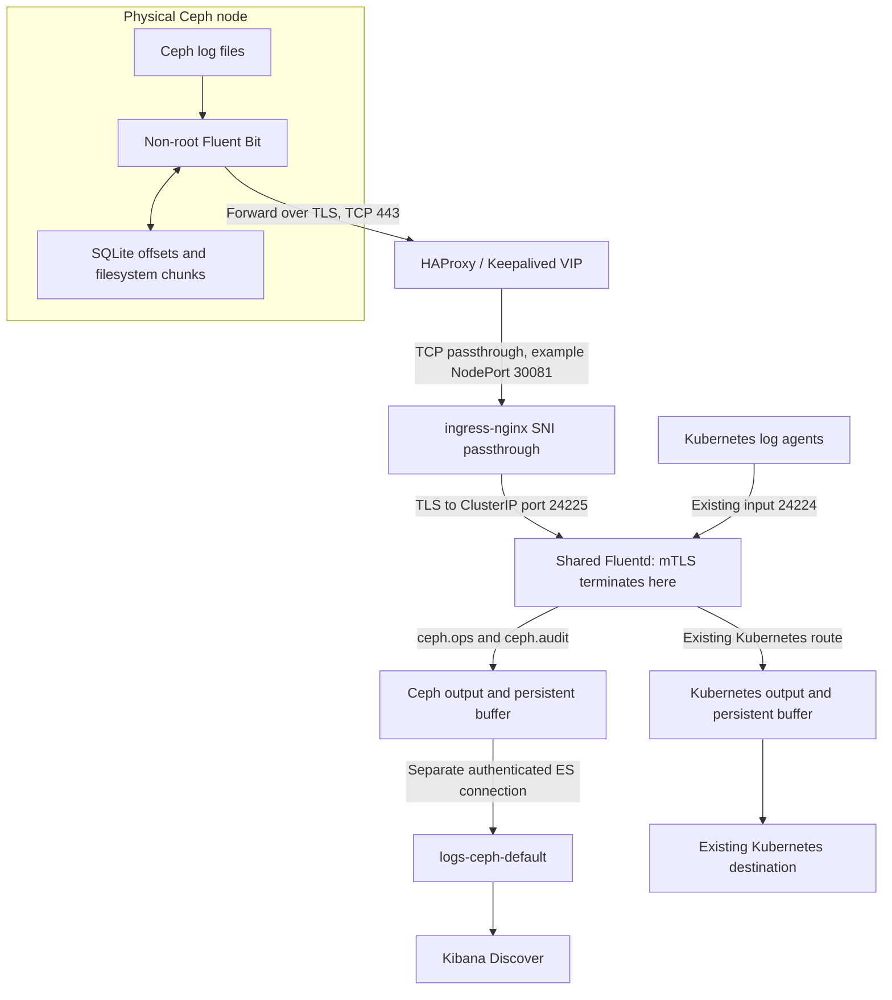

# Ceph centralized logging

An evidence-based engineering guide to collecting logs from physical Ceph nodes into a shared Kubernetes logging platform, with Fluent Bit, mutual TLS, Fluentd, and Elasticsearch.

**Publication status: public reference project.** The repository owner authorized public release of the sanitized material on 10 November 2026 and confirmed publication authority. No open-source license is granted. The confidential source runbook is deliberately excluded. All infrastructure identities are placeholders. Read the [publication review](docs/publication-review.md) before sharing this project.

**Maintenance status:** this project records an implementation, not a supported turnkey distribution. Community ingress-nginx retired in March 2026; new deployments require a maintained transport design and compatibility testing. See [version and evidence boundaries](docs/evidence.md).

## The problem

Storage logs lived on physical hosts while the existing log platform ran in Kubernetes. Bringing those logs into Elasticsearch required more than opening a port: the collector needed safe read access to Ceph files, durable local state, authenticated transport, useful parsing, and enough shared capacity to avoid delaying Kubernetes logs.

The source describes a pilot followed by a reported five-host rollout. Three shared Fluentd pods accepted both Kubernetes and Ceph traffic. These are source-reported observations, not deployments independently reproduced by this repository.

## Architecture



The [diagram source](diagrams/architecture.mmd), [rendered SVG](diagrams/architecture.svg), and [port map](docs/architecture.md) make the trust boundaries explicit. Fluent Forward is a binary protocol. Port 443 does not make it HTTP. HAProxy and ingress pass the encrypted stream to Fluentd; Elasticsearch is a separate connection whose exact TLS configuration must be inspected.

## Engineering goals

- Protect Ceph: collect files without restarting or reconfiguring storage daemons.
- Use a dedicated non-root reader with narrow ACLs and bounded resource use.
- Preserve Tail offsets and queued chunks through ordinary restarts.
- Authenticate clients with distinct certificates; keep Elasticsearch credentials off storage hosts.
- Preserve Kubernetes delivery while adding Ceph volume to shared collectors.
- Keep raw records and useful `ceph_*` fields in one `logs-ceph-default` stream.

## Stack and configuration

| Component | Responsibility | Evidence |
|---|---|---|
| Ceph / cephadm / Podman | Local daemon, cluster, audit and RGW logs | Daemons reported 19.2.7; cephadm utility separately 19.2.3 |
| Fluent Bit | Tail, parse, enrich, buffer, Forward | RPM 2.2.2; two final snapshots extracted |
| HAProxy / Keepalived | VIP and TCP transport | Full live configuration absent |
| ingress-nginx | SNI TLS passthrough to ClusterIP | Legacy implementation; retired upstream |
| Fluent Operator / Fluentd | Shared receiver, filters and outputs | Chart discussed as 4.3.0; runtime reported 1.19.0 |
| Vault / cert-manager | Certificate issuance | Issuer policy and versions not supplied |
| Elasticsearch / Kibana | Data stream, search and investigation | Versions and complete production role/template absent |
| Prometheus / Grafana | Capacity and delivery monitoring | Metric examples; no exported dashboard supplied |

The [configuration catalog](docs/configuration.md) identifies provenance, prerequisites, parameters, deployment, verification and rollback for every significant file. Only the Fluent Bit main and parser files are **sanitized snapshots**. Other files are **examples or fragments**, never complete recovered production manifests.

## Security and reliability

The inbound TLS session ends at Fluentd, where a trusted client CA is configured. Trusting that CA is broader than authorizing an exact list of nodes. SNI is routing information, not proof of server identity. The historical Fluent Bit binary rejected `tls.verify_hostname`; independent OpenSSL hostname checks do not establish that the agent itself enforces the same policy. This remains a deployment security gate.

The snapshot uses separate SQLite databases for four inputs and filesystem chunks with a **4G output limit**. Forward ACKs permit retries and possible duplicates; they do not confirm Elasticsearch indexing. Oversized lines, output limits, rotation, disk failure and interrupted persistence can still lose records. Read [security](docs/security.md) and [performance and reliability](docs/performance.md) before rollout.

## Start here

1. Establish ownership and target versions with [prerequisites](docs/prerequisites.md) and [evidence](docs/evidence.md).
2. Review [architecture](docs/architecture.md), [security](docs/security.md), and the [configuration catalog](docs/configuration.md).
3. Follow [installation](docs/installation.md): receiver readiness, one-node canary, then controlled Tail activation.
4. Apply the [validation gates](docs/validation.md), including continuing Kubernetes delivery.
5. Use [operations](docs/operations.md), [certificate lifecycle](docs/certificate-lifecycle.md), and [rollback](docs/rollback.md) for Day 2.

This is intentionally not a `kubectl apply -f configs/` quick start. Fragments, missing production CRs, unresolved target versions and the retired controller require engineering review.

## Troubleshooting and lessons

Start with the [failure isolation matrix](docs/troubleshooting.md). A healthy pod does not prove port 24225 is listening; a TLS handshake does not prove a canary was indexed; fresh Ceph logs do not prove Kubernetes logging is healthy.

The most useful [lessons](docs/lessons-learned.md) are operational: named ACLs can defeat apparent group access, broad filters can charge every stream for another stream's processing, certificate renewal and host deployment are different tasks, and queues buy finite recovery time.

See [Elasticsearch and search](docs/elasticsearch.md), [optional journal collection](docs/optional-journal.md), [source coverage](docs/source-coverage.md), [quality report](docs/quality-report.md), [publishing steps](docs/publishing.md), and [contribution guidelines](CONTRIBUTING.md).

## Local documentation checks

```bash
npm ci --ignore-scripts
npm run check
npm run lint:markdown
```

These commands validate repository artifacts, not infrastructure. See [validation](docs/validation.md) for Bash, ShellCheck, Gitleaks, Kubernetes-schema and runtime checks. No production system is contacted by the default checks.
